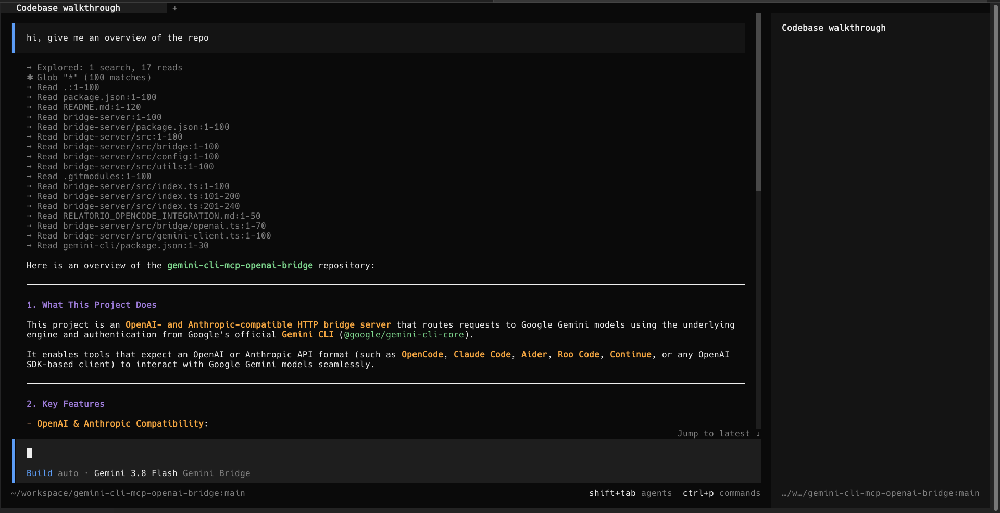
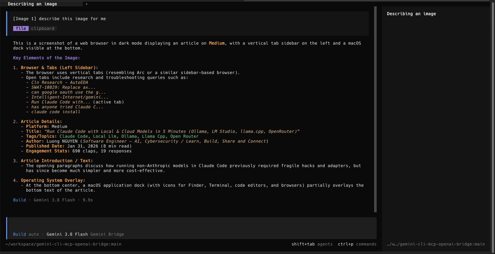
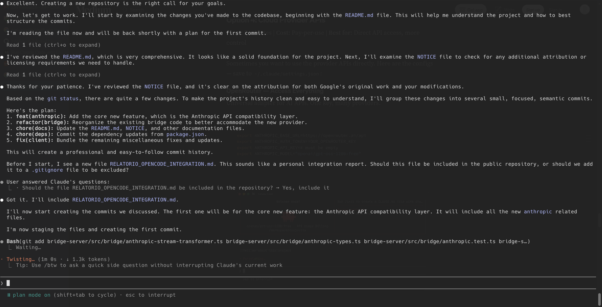
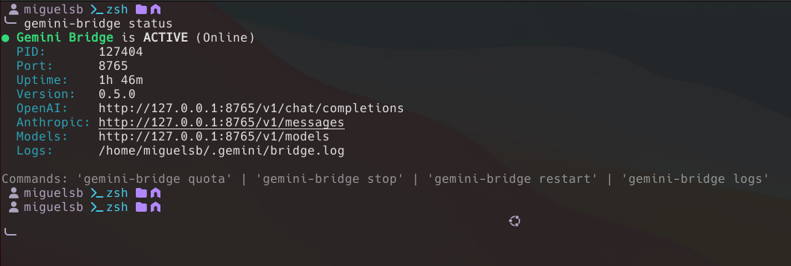
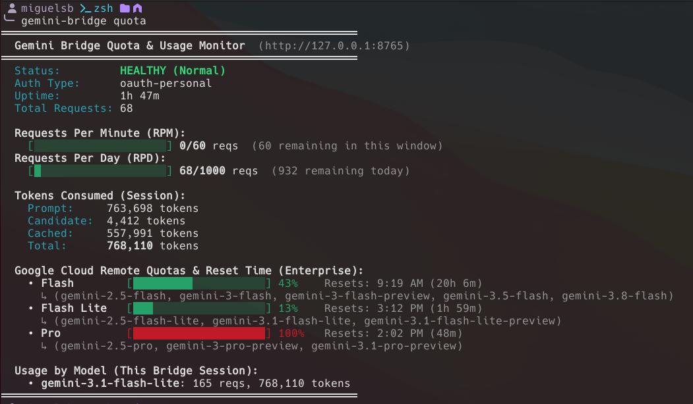

# Gemini CLI OpenAI Bridge

[](https://opensource.org/licenses/Apache-2.0)
[](https://nodejs.org/)
[](https://github.com/msb7-jpg/gemini-cli-openai-bridge)

> **Standalone Evolution & Maintenance**  
> Built upon the open-source [Google Gemini CLI](https://github.com/google-gemini/gemini-cli) core and inspired by the archived [`Intelligent-Internet/gemini-cli-mcp-openai-bridge`](https://github.com/Intelligent-Internet/gemini-cli-mcp-openai-bridge).

`@migueldsbatista/gemini-cli-openai-bridge` provides a high-performance **OpenAI-compatible** and **Anthropic Messages-compatible** HTTP API bridge that routes requests directly to Google Gemini models using the official authentication, session management, and execution engine of Google's Gemini CLI.

It is specifically tailored for AI coding agents and developer workflows such as **[OpenCode](https://opencode.ai)**, **Claude Code**, **OpenAI Codex**, **VSCode Copilot Chat**, **Zed Editor**, **Aider**, **Roo Code**, **Continue**, and **Open WebUI**.

---

## Table of Contents

- [Features](#features)
- [API Compatibility](#api-compatibility)
- [Installing](#installing)
  - [1-Click Setup Prompt for AI Agents](#1-click-setup-prompt-for-ai-agents)
  - [Manual Installation](#manual-installation)
  - [Build from Source](#build-from-source)
- [Authentication](#authentication)
- [Integrations](#integrations)
- [CLI Commands & Daemon Control](#cli-commands--daemon-control)
  - [Real-Time Quota & Usage Monitoring](#real-time-quota--usage-monitoring)
- [CLI Options](#cli-options)
- [Media & Demos](#media--demos)
- [Differences from the Archived Upstream Project](#differences-from-the-archived-upstream-project)
- [Gemini CLI Version Compatibility Note](#gemini-cli-version-compatibility-note)
- [Testing & Development](#testing--development)
- [License & Attribution](#license--attribution)

---

## Features

- **OpenAI and Anthropic API Parity**: Serves standard `/v1/chat/completions` alongside full Anthropic `/v1/messages` (SSE streaming and non-streaming) with `/health` and Claude connection probes (`/api/hello`). See [API Compatibility](#api-compatibility) and [Integrations](#integrations).
- **Thought Signature Preservation**: Seamlessly extracts, caches, and preserves `thought_signature` tokens across multi-turn function calls, enabling Gemini reasoning models (such as Gemini 2.5 Flash/Pro and Gemini 3.8 Flash). See [Integrations](#integrations).
- **Parallel Tool Calling & Turn Parity**: Bundles OpenAI `role: "tool"` responses into Gemini's single `user` turn constraints, matching parts 1:1 and synthesizing fallback responses if any tool call is omitted.
- **Exhaustive Schema Sanitization**: Translates modern OpenAPI 3.1 and JSON Schema constructs (`exclusiveMinimum`, `exclusiveMaximum`, `const`, `oneOf`, `$schema`, `additionalProperties`) into strict Gemini Protobuf schemas without HTTP 400 errors.
- **Dynamic Per-Request Model Selection**: Dynamically routes requests according to the model specified in the request payload (`gemini-3.8-flash`, `gemini-2.5-pro`, etc.) rather than forcing a static default.
- **Real-Time Quota and Usage Tracking**: An in-memory sliding window tracker monitors Requests Per Minute (RPM), Requests Per Day (RPD), and session token consumption with standard OpenAI rate limit headers. See [Real-Time Quota & Usage Monitoring](#real-time-quota--usage-monitoring).
- **Frictionless Authentication**: Inherits existing Gemini CLI credentials (Google OAuth interactive login) or uses the `GEMINI_API_KEY` environment variable. See [Authentication](#authentication).
- **Comprehensive Agent & Provider Support**: Out-of-the-box configuration guides and prompt templates for OpenCode, Claude Code, VSCode Copilot Chat, Zed Editor, and more. See [Integrations](#integrations).
- **Fast CLI Daemon Management**: Sub-100ms background daemon control commands for starting, stopping, restarting, viewing logs, and monitoring status. See [CLI Commands & Daemon Control](#cli-commands--daemon-control).

---

## API Compatibility

| API Specification | Endpoint | Supported Features | Status |
|---|---|---|---|
| **OpenAI Chat Completions** | `POST /v1/chat/completions` | SSE streaming, multi-turn tool calling, multimodal vision, reasoning effort | ✓ Supported |
| **Anthropic Messages** | `POST /v1/messages` | SSE streaming, Claude Code tools (`Bash`, `FileRead`, `FileEdit`), system prompts | ✓ Supported |
| **Model Discovery** | `GET /v1/models` | OpenAI-compatible model listing and dynamic route discovery | ✓ Supported |
| **Health & Handshake** | `GET /health`, `GET /api/hello` | Server health status probe and Claude Code connection handshake | ✓ Supported |
| **Quota & Rate Limits** | `GET /v1/quota`, `GET /v1/usage` | Sliding window RPM/RPD inspection and standard rate limit headers | ✓ Supported |

---

## Installing

### 1-Click Setup Prompt for AI Agents

If you are using an AI coding assistant (such as **OpenCode**, **Claude Code**, **OpenAI Codex**, **VSCode Copilot**, **Zed**, **Cursor**, **Aider**, or **Roo Code**), simply copy and paste this prompt:

```markdown
Please set up the Gemini CLI OpenAI Bridge by reading the instructions at:
- Setup Guide: https://github.com/msb7-jpg/gemini-cli-openai-bridge/blob/main/docs/setup-legacy.md
- OpenCode Setup: https://github.com/msb7-jpg/gemini-cli-openai-bridge/blob/main/docs/integrations/opencode.md
- Claude Code Setup: https://github.com/msb7-jpg/gemini-cli-openai-bridge/blob/main/docs/integrations/claude-code.md
- OpenAI Codex Setup: https://github.com/msb7-jpg/gemini-cli-openai-bridge/blob/main/docs/integrations/codex.md
- VSCode Copilot Setup: https://github.com/msb7-jpg/gemini-cli-openai-bridge/blob/main/docs/integrations/vscode.md
- Zed Editor Setup: https://github.com/msb7-jpg/gemini-cli-openai-bridge/blob/main/docs/integrations/zed.md

Follow these instructions to install @migueldsbatista/gemini-cli-openai-bridge globally, configure my credentials, and verify the integration.
```

Dedicated prompt files:
- 🤖 OpenCode: [docs/integrations/opencode.md](./docs/integrations/opencode.md)
- 🎭 Claude Code: [docs/integrations/claude-code.md](./docs/integrations/claude-code.md)
- 💻 VSCode Copilot: [docs/integrations/vscode.md](./docs/integrations/vscode.md)
- ⚡ Zed Editor: [docs/integrations/zed.md](./docs/integrations/zed.md)
- 🧠 OpenAI Codex: [docs/integrations/codex.md](./docs/integrations/codex.md)
- 📋 Comprehensive Setup Guide: [docs/setup-legacy.md](./docs/setup-legacy.md)

### Manual Installation

Install the bridge globally using npm:

```bash
npm install -g @migueldsbatista/gemini-cli-openai-bridge
```

Start the bridge daemon:
```bash
gemini-bridge
```

Alternatively, you can run the bridge directly without global installation via npx:
```bash
npx @migueldsbatista/gemini-cli-openai-bridge --port=8765
```

### Build from Source

To build and run from source (recommended for developers and contributors):

```bash
git clone --recurse-submodules https://github.com/msb7-jpg/gemini-cli-openai-bridge.git
cd gemini-cli-openai-bridge
npm run install
npm run build
npm link
gemini-bridge
```

If you previously cloned without submodules, initialize them first:
```bash
git submodule update --init --recursive
npm run install
npm run build
npm link
gemini-bridge
```

---

## 🔑 Authentication

The bridge requires authentication to access Google Gemini APIs:

1. **Option A: Gemini CLI OAuth (Interactive - Recommended)**  
   If you have already logged in via `gemini-cli` (`gemini auth login` or `.gemini/settings.json`), the bridge will automatically use your cached credentials:
   ```bash
   gemini auth login
   ```

2. **Option B: Environment Variable (CI / Headless Servers)**  
   Set your API key before starting the server in your environment variables:
   ```bash
   export GEMINI_API_KEY="AIzaSy..."
   gemini-bridge
   ```

---

## 🔌 Integrations

The bridge seamlessly connects with popular AI coding agents, editors, and developer tools via standard OpenAI `/v1/chat/completions` and Anthropic `/v1/messages` endpoints.

Detailed step-by-step setup guides and prompt templates:

- 🤖 **[OpenCode Setup](./docs/integrations/opencode.md)**: Configuration for `~/.config/opencode/opencode.json` using `@ai-sdk/openai-compatible`.
- 🎭 **[Claude Code Setup](./docs/integrations/claude-code.md)**: Configuration for Anthropic Messages API routing via environment variables.
- 💻 **[VSCode Copilot Chat Setup](./docs/integrations/vscode.md)**: Configuration for `chatLanguageModels.json` custom endpoints.
- ⚡ **[Zed Editor Setup](./docs/integrations/zed.md)**: Configuration for Zed `settings.json` under `openai_compatible`.
- 🧠 **[OpenAI Codex Setup](./docs/integrations/codex.md)**: Configuration for `~/.codex/config.toml` targeting the Responses API.

---

## 💻 CLI Commands & Daemon Control

The bridge provides instant CLI daemon management commands with fast-path execution (< 100ms):

```bash
gemini-bridge               # Start the bridge daemon in background (with live spinner)
gemini-bridge status        # Check daemon status, uptime, PID, and active ports
gemini-bridge quota         # View real-time quota, RPM/RPD limits, and token usage
gemini-bridge restart       # Restart the background daemon
gemini-bridge stop          # Stop the running bridge daemon
gemini-bridge logs          # View recent server log output (-f to follow)
```

### 📊 Real-Time Quota & Usage Monitoring

Google Gemini does not provide a public pre-request quota remaining API. The bridge implements an in-memory **Sliding Window Quota & Usage Tracker** that:
- Monitors **Requests Per Minute (RPM)** and **Requests Per Day (RPD)**.
- Automatically calculates remaining capacity against your auth tier (e.g. 60 RPM / 1,000 RPD for Gemini Code Assist OAuth, or 15 RPM for Free API keys).
- Captures real `usageMetadata` from Gemini responses (prompt tokens, candidate tokens, and cached tokens).
- Detects proactive Google HTTP 429 quota exhaustion events (e.g. Pro Quota fallback to Flash) and extracts `Retry-After` windows.
- Exposes standard OpenAI rate limit headers (`x-ratelimit-remaining-requests`, `x-ratelimit-reset-requests`) on every response.
- Exposes `GET /v1/quota` (and `GET /v1/usage`) for agent harnesses, dashboards, or scripts.

Example CLI output:
```
══════════════════════════════════════════════════════
  Gemini Bridge Quota & Usage Monitor  (http://127.0.0.1:8765)
══════════════════════════════════════════════════════
  Status:         HEALTHY (Normal)
  Auth Type:      oauth-personal
  Uptime:         1m 5s
  Total Requests: 4

  Requests Per Minute (RPM):
    [█░░░░░░░░░░░░░░░░░░░] 3/60 reqs  (57 remaining in this window)
  Requests Per Day (RPD):
    [░░░░░░░░░░░░░░░░░░░░] 4/1000 reqs  (996 remaining today)

  Tokens Consumed (Session):
    Prompt:     242,850 tokens
    Candidate:  68 tokens
    Cached:     110,591 tokens
    Total:      242,918 tokens

  Usage by Model (This Bridge Session):
    • gemini-3.8-flash: 6 reqs, 242,918 tokens
══════════════════════════════════════════════════════
```

---

## 💻 CLI Options

```
Options:
  -h, --host                    Host address to listen on (default: 127.0.0.1)
  -p, --port                    Port to listen on (default: 8765, or GEMINI_BRIDGE_PORT)
  -d, --target-dir              Working directory for operations (default: current directory)
      --debug                   Enable detailed debug logging (default: false)
      --use-internal-prompt     Load internal GEMINI.md prompts (default: false)
      --tools-model             Specify a fallback model for tool execution
      --mode                    Security mode: read-only, edit, configured, yolo
      --i-know-what-i-am-doing  Bypass interactive confirmation for yolo mode
  -?, --help                    Show help
```

---

## 📸 Media & Demos

### 1. OpenCode Multi-Turn Autonomous Tool Calls
OpenCode running complex planning and bash tool execution with `gemini-3.8-flash`:


### 2. OpenCode Multimodal Vision Analysis
Gemini thinking models analyzing visual screenshot inputs directly inside OpenCode:


### 3. Claude Code Running on Gemini 3.8 Flash
Claude Code transparently operating through our Anthropic Messages API (`/v1/messages`):


### 4. Background Daemon Status & Quick Probes
Real-time active daemon monitoring with `gemini-bridge status`:


### 5. Quota & Token Usage Dashboard
Live terminal dashboard showing RPM/RPD windows, token usage, and enterprise quotas with `gemini-bridge quota`:


---

## 🆚 Differences from the Archived Upstream Project

The original upstream repository [`Intelligent-Internet/gemini-cli-mcp-openai-bridge`](https://github.com/Intelligent-Internet/gemini-cli-mcp-openai-bridge) was archived in July 2026. This project is a standalone continuation and refactor that addresses critical issues and modern agent requirements:

| Feature / Area | Original Archived Project | `@migueldsbatista/gemini-cli-openai-bridge` |
|---|---|---|
| **Anthropic Messages API (`/v1/messages`)** | ❌ Not supported | ✅ **Fully supported**: native integration for **Claude Code** with streaming & tools. |
| **`thought_signature` Handling** | ❌ Stripped / discarded, breaking multi-turn tool calling with thinking models | ✅ **Cached & injected** across turns via `thoughtSignatureCache`, enabling Gemini 2.5 & 3.x thinking models. |
| **JSON Schema Sanitization** | ❌ Minimal (only `$schema` & `additionalProperties`), crashing on modern Zod / Effect Schemas | ✅ **Strict whitelist & conversions** (`exclusiveMinimum`, `const` to `enum`, `oneOf` to `anyOf`, type arrays). |
| **Parallel Tool Calls Parity** | ❌ Mapped 1:1 as separate `user` turns, causing HTTP 400 part mismatch errors | ✅ **Batch grouped** into a single Gemini `user` turn with ordered 1:1 part matching and synthetic fallback. |
| **Model Routing** | ❌ Hardcoded to default `gemini-2.5-flash` regardless of request `model` | ✅ **Dynamic request Proxy**: routes dynamically to requested model (`gemini-3.8-flash`, `gemini-2.5-pro`, etc.). |
| **Supported Models** | ❌ Outdated model listing | ✅ Updated with **Gemini 3.8 Flash**, **Gemini 3 Flash/Pro Preview**, and **Gemini 2.5 Pro/Flash**. |
| **Codebase Architecture** | ⚠️ Heavy MCP proxy bloat that broke under upstream CLI updates | 🚀 **Streamlined & focused**: dedicated HTTP API bridge (OpenAI + Anthropic) with 100% passing test coverage. |

---

## ℹ️ Gemini CLI Version Compatibility Note

- **User CLI Environment**: The bridge is 100% compatible with the latest stable releases of Google's official Gemini CLI (`@google/gemini-cli@0.66.0+`). You can use `gemini auth login` from any modern CLI release.
- **Internal Core Submodule**: The build workspace embeds the stable `@google/gemini-cli-core` engine. This decoupling shields the bridge from upstream breaking changes (such as monorepo reorganizations and internal API changes in Google's unreleased packages), while our adapter layer handles all modern protocol features (Protobuf schema sanitization, cryptographic thought signatures, Anthropic Messages translation, and Gemini 3.8 Flash model execution).

---

## 🧪 Testing & Development

For guidelines on setting up local development, running tests, rebuilding with `npm run port`, and publishing, please refer to [CONTRIBUTING.md](CONTRIBUTING.md).

Run the test suite:
```bash
npm test
```

---

## 🗺️ Roadmap

We are continuously evolving the bridge to improve developer experience, optimize token consumption, and simplify setup:

- **🧠 `adaptive-gemini` Intelligent Routing Engine**: A native virtual model and Responses API routing layer that dynamically selects the optimal model tier (`Flash Lite`, `Flash`, or `Pro`) based on task complexity, tools, and token quotas—bringing smart delegation to *any* AI harness (Claude Code, OpenAI Codex, Aider, Roo Code).
- **🩺 `gemini-bridge doctor`**: Interactive CLI diagnostics command to verify OAuth credentials, network connectivity, API keys, and daemon health in seconds.
- **⚡ Client Setup Wizards (`gemini-bridge setup <client>`)**: One-click configuration for OpenCode, Claude Code, Codex, Zed, and Continue.
- **📊 Embedded Web Dashboard (`/dashboard`)**: Real-time request visualizer, reasoning inspector, and token/quota monitoring.
- **🛡️ Resilience & Auth**: Proactive background OAuth token refresh and human-readable Google API error translations.
- **📚 Protocol Expansion**: Support for OpenAI-compatible `/v1/embeddings` and Anthropic document/PDF block parsing.

👉 Read the full architectural roadmap and milestones in [**docs/roadmap.md**](docs/roadmap.md).

---

## 📄 License & Attribution

- Licensed under [Apache-2.0](LICENSE).
- Core execution engine and authentication: [Google Gemini CLI](https://github.com/google-gemini/gemini-cli) (Copyright Google LLC).
- Architectural foundation: inspired by the archived [`Intelligent-Internet/gemini-cli-mcp-openai-bridge`](https://github.com/Intelligent-Internet/gemini-cli-mcp-openai-bridge) (Copyright 2025 Intelligent-Internet).

